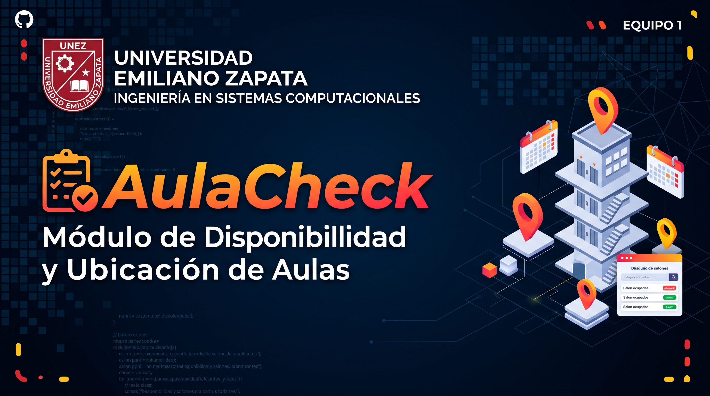

  

# 🏫 Sistema Escolar AulaCheck (Módulo UNEZ)

> **AulaCheck** es un nuevo módulo tecnológico integrado directamente al portal institucional de la Universidad Emiliano Zapata (UNEZ). Su objetivo es permitir a la comunidad escolar consultar en tiempo real la disponibilidad, horarios y ubicación exacta de las aulas libres, optimizando la organización diaria y evitando traslados físicos innecesarios por los diferentes pisos de los edificios.

---

## 👥 Personal Involucrado y Atribuciones

Este proyecto es desarrollado y mantenido por el **Equipo 1** de Ingeniería en Sistemas Computacionales (Séptimo Tetramestre):

*   **Christian Verastegui** (Líder de Proyecto & UI/UX Designer) ─ [@AboYTeSs07-github](https://github.com/AboYTeSs07)
    *   *Aportaciones:* Coordinación del proyecto, diseño de interfaces, prototipos en Google AI Studio y documentación final.
*   **Alberto de los Reyes** (Desarrollador Backend & DBA) ─ [@alberto-github](https://github.com/alberto-github)
    *   *Aportaciones:* Diseño de la base de datos segura, lógica del servidor y cronograma del proyecto (Gantt).
*   **Alexis Alejo** (Desarrollador Fullstack & QA) ─ [@alexis-github](https://github.com/alexis-github)
    *   *Aportaciones:* Programación del sistema, control de versiones, pruebas de calidad y estabilidad de la integración.

---

## 🛠️ Herramientas Utilizadas

*   **Google AI Studio**: Para el prototipado rápido y creación de la interfaz del portal.
*   **Visual Studio Code / C#**: Para el desarrollo de la aplicación real y la integración con el portal institucional.
*   **Base de Datos (MySQL / PostgreSQL)**: Gestión del registro de espacios académicos y roles de usuario.
*   **GitHub**: Control de versiones y colaboración del equipo.

---

## 📅 Estado del Proyecto

Para conocer el progreso detallado de las actividades, consulta nuestro **Calendario y Diagrama de Gantt** en la documentación interna. Actualmente nos encontramos en la **Fase de Entrega y Documentación**.

---
_Proyecto académico para la materia de Gestión de Proyectos de Software — Universidad Emiliano Zapata._
